# V1 Slice 1A Execution Plan — HTTP API Boundary Discovery & Design

| | |
|---|---|
| **Plan version** | 0.1.0 (draft — FOR REVIEW) |
| **Date** | 2026-09-02 |
| **Author** | AutoClaw |
| **Instruction source** | User directive "Slice 1A — HTTP API Boundary Discovery & Design" (attached 2026-09-02 22:00) |
| **Applies to** | `dsa-tutor-v1` repo (local `v1/` + GitHub `7ajinkya/dsa-tutor-v1`), baseline tag `v1-baseline` |
| **Deliverable of Slice 1A** | One document: `docs/V1_SLICE_1_API_BOUNDARY_DESIGN.md` |
| **Status rule** | **No Slice 1A execution starts until this plan is reviewed, revised, and approved (see §12).** |

**Navigation:** [1 Objectives](#1-objectives--context) · [2 Scope](#2-scope-boundary) · [3 Inspection scope](#3-inspection-scope) · [4 Tasks & milestones](#4-task-breakdown--milestones) · [5 Traceability](#5-instruction-traceability-matrix) · [6 Acceptance gates](#6-acceptance--verification-gates) · [7 Risks](#7-risk-register) · [8 Exception paths](#8-exception-paths) · [9 Rollback](#9-rollback--contingency) · [10 Reviewer pack](#10-reviewer-pack) · [11 Versioning](#11-versioning--change-log-scheme) · [12 Handover & trigger](#12-handover--start-of-work-trigger) · [13 Beyond Part 1](#13-beyond-part-1-placeholders) · [14 Change log](#14-change-log)

---

## 1. Objectives & context

Slice 1A is the **design/inspection-only first part of Slice 1**. Its single deliverable is an
implementation-ready API boundary specification (`docs/V1_SLICE_1_API_BOUNDARY_DESIGN.md`) that a
reviewer can approve before any HTTP code exists.

Intended V1 architecture being designed toward (from the instruction, to be verified against code):

```
Vue frontend -> HTTP/JSON -> Thin Python HTTP API -> TutorService -> Learning engine -> MySQL
```

The plan exists because Slice 1 is large; Slice 1A is deliberately small and verifiable, and its
output de-risks every later part (endpoint implementation, Vue frontend).

## 2. Scope boundary

### 2.1 IN scope (exactly what Slice 1A produces)

1. Direct inspection of the **actual source code** (not just the baseline report) of the files in §3.
2. One new Markdown document: `docs/V1_SLICE_1_API_BOUNDARY_DESIGN.md`, containing all **14 mandated
   sections** (see §5 mapping): current application boundary + full TutorService method inventory;
   TurnView inspection; endpoint classification (KEEP / MODIFY / REMOVE / ADD); public JSON schemas
   with a consistent error envelope; learner-facing activity envelope; TurnView-to-public mapping
   table; session model (persistent vs session state); error handling mapped to real exceptions;
   security/exposure boundary + local-dev CORS policy; storage selection; API test matrix; the ten
   architectural invariants; Spring-Boot migration consideration; open questions.
3. Read-only verification runs (test suite, read-only Python introspection) used as inspection aids.
4. A final chat report: file created, sources inspected, findings, unresolved questions, git status,
   no-behavior-change confirmation (instruction IA-23).

### 2.2 OUT of scope (explicitly forbidden by the instruction — verified by gate G9)

- No FastAPI / Flask / stdlib HTTP implementation, no HTTP server, no frontend or Vue files.
- No changes to: application behavior, learning engine, domain models, DB schema, curriculum, AI behavior.
- No new dependencies, no `requirements.txt` changes, no tests added, no database changes.
- No authentication (CORS policy is documented, not enforced by auth).

### 2.3 The endpoint working proposal under evaluation (from the instruction)

Slice 1A must evaluate and classify each of these 13 proposed endpoints (KEEP / MODIFY / REMOVE / ADD,
with code-cited reasons); the proposal is the instruction's starting point, not a commitment:

```
Session:
  POST /api/v1/sessions
  GET  /api/v1/sessions/{session_id}
  POST /api/v1/sessions/{session_id}/resume
  POST /api/v1/sessions/{session_id}/stop

Activity interaction:
  POST /api/v1/sessions/{session_id}/activities/{activity_id}/answer
  POST /api/v1/sessions/{session_id}/activities/{activity_id}/hint
  POST /api/v1/sessions/{session_id}/activities/{activity_id}/reveal-solution
  POST /api/v1/sessions/{session_id}/activities/{activity_id}/explain

Decision/progress:
  GET  /api/v1/sessions/{session_id}/why
  POST /api/v1/sessions/{session_id}/confidence
  GET  /api/v1/learner/progress
  GET  /api/v1/home
```

(Traceability IA-10; design doc will classify all 13 with code evidence — gate G6. Also evaluates the
instruction's refinement: mutation responses should return the next authoritative activity when that
avoids round trips.)

### 2.4 Deferred to later parts of Slice 1 (placeholders only — §13)

- Slice 1B (proposed): implement the approved HTTP endpoints; Slice 1C (proposed): Vue frontend shell.
- Anything the reviewer moves out of Slice 1A during review lands there, not here.

## 3. Inspection scope

| # | Source (actual repo path) | What must be extracted for the design doc |
|---|---|---|
| S1 | `dsa_tutor/app/service.py` (41.3 KB) | Every public `TutorService` method: name, parameters, return type, side effects, persistence behavior, exceptions/errors, HTTP-exposure appropriateness |
| S2 | `dsa_tutor/app/interactive.py` (9.0 KB) | What the CLI actually renders per turn (ground truth for what a learner needs), command surface (`hint/why/explain/progress/solution/stop`), fallback messaging |
| S3 | `dsa_tutor/domain/engine.py` + `domain/models.py` | Engine decision surfaces (`select_next`, `decide_after_attempt`, `check_readiness`), `EngineDecision.why`, `MasteryState`, `EngineAction`, `TurnView`-adjacent enums (activity types, roles, scopes) |
| S4 | `dsa_tutor/persistence/*` | Storage interface shared by `MySQLStorage`/`MemoryStorage`; transaction boundary (`record_interaction`); session lifecycle persistence |
| S5 | `dsa_tutor/cli.py` + `config.py` | Use-case wiring, config surface relevant to API (budgets, AI config, log dir), what `_build_service` does (storage selection precedent) |
| S6 | `tests/` (11 files, esp. `test_service_integration.py`, `test_cli_e2e.py`) | Existing behavioral guarantees the API must preserve; actual exception/assertion behavior |
| S7 | `dsa_tutor/ai/*` | The 5-operation AI interface, `EvaluationResult`/`HintResult`/`ExplainResult` fields, `degraded` flag — which parts are learner-facing vs internal |
| S8 | Runtime cross-check (read-only) | `inspect.signature`/`dir()` enumeration of `TutorService` and `TurnView` to guarantee the inventory is complete; offline smoke walk to enumerate actual `TurnView.extra` keys |

Technique constraint: inspection is **read-only** (reading files, running the existing test suite,
running Python that only *reads* objects). Nothing outside `docs/` + `plans/` is written.

## 4. Task breakdown & milestones

Effort = focused work hours (draft estimates for reviewer validation; AI-executed, human-reviewed).

| ID | Task | Produces | Depends on | Est. |
|---|---|---|---|---|
| T0 | Preflight: confirm baseline state (clean tree, tests green), freeze scope, re-read instruction | Preflight note in working memory | — | 0.25 h |
| T1 | Inspection I — full `TutorService` method inventory + runtime signature cross-check (S1, S8) | Method inventory table (raw) | T0 | 1.5 h |
| T2 | Inspection II — TurnView field audit, engine/models/persistence/CLI/tests/AI pass, exception inventory (S2–S7) | Field/exception/session-lifecycle notes | T0 | 1.5 h |
| T3 | Draft design doc §1–§2 (current boundary, method table; TurnView inspection + public JSON proposal) | Doc sections | T1, T2 | 1.0 h |
| T4 | Draft §3–§4 (endpoint classification with code evidence; public schemas + error envelope) | Doc sections | T1, T2 | 1.25 h |
| T5 | Draft §5–§7 (activity envelope; TurnView mapping table; session model) | Doc sections | T1, T2 | 1.0 h |
| T6 | Draft §8–§10 (error handling; security/CORS; storage) | Doc sections | T2, T4 | 0.75 h |
| T7 | Draft §11–§13 (test matrix; invariants; migration) | Doc sections | T1–T6 | 0.5 h |
| T8 | Draft §14 open questions; compile findings; complete traceability coverage | Doc section + findings list | T3–T7 | 0.5 h |
| T9 | Verification gates G1–G10 (§6): completeness greps, secrets scan, test suite re-run, diff-scope check | Gate results | T8 | 0.75 h |
| T10 | Commit + push the doc; deliver final report (IA-23 items); STOP | Delivered design doc | T9 | 0.25 h |

**Total draft estimate: 9.25 h** across three milestones:

| Milestone | Content | Tasks | Est. |
|---|---|---|---|
| M1 — Inspection complete | Method/field/exception inventory verified against runtime | T0–T2 | 3.25 h |
| M2 — Design doc drafted | All 14 sections drafted with code citations | T3–T8 | 5.0 h |
| M3 — Verified & delivered | Gates green, doc committed/pushed, report delivered | T9–T10 | 1.0 h |

Timeline (indicative sequence, not calendar commitment):

```mermaid
gantt
  dateFormat X
  axisFormat %s
  section M1 Inspection
  T0 preflight        :0, 1
  T1 service inventory:1, 3
  T2 deep inspection  :1, 3
  section M2 Drafting
  T3 boundary+TurnView:3, 5
  T4 endpoints+schemas:3, 6
  T5 envelope+mapping :5, 7
  T6 errors+security  :6, 8
  T7 tests+invariants :7, 9
  T8 open questions   :8, 10
  section M3 Delivery
  T9 gates            :10, 12
  T10 commit+report   :12, 13
```



Table fallback (canonical): T0 → {T1, T2} → {T3, T4, T5} → {T6, T7} → T8 → T9 → T10.

## 5. Instruction traceability matrix

Every numbered instruction item from the attachment (IA-01 … IA-23) maps to at least one task and one
design-doc section. Nothing is dropped; open questions are flagged where a reviewer decision is needed.

| ID | Instruction item (abbreviated) | Task(s) | Design-doc section | Status |
|---|---|---|---|---|
| IA-01 | No implementation: no FastAPI/Flask/stdlib HTTP, Vue, frontend, engine/domain/schema/curriculum/AI changes | T0, T9 (gate G9) | §2.2 of plan; enforced during execution | Planned |
| IA-02 | Do NOT modify application behavior | T9 (gate G9: tests + diff scope) | n/a (constraint) | Planned |
| IA-03 | Goal: inspect real codebase, produce implementation-ready API boundary spec for review | T1–T8 | whole doc | Planned |
| IA-04 | Context: thin transport adapter; engine authoritative (curriculum/prereqs/progression/mastery/readiness/selection/remediation); AI behind abstraction | T3 | §1, §12 (invariants) | Planned |
| IA-05 | Inspect actual sources: service.py, interactive.py, engine.py, models.py, persistence, CLI wiring, tests, AI contracts | T1, T2 | §1–§14 evidence base | Planned |
| IA-06 | Do not rely only on the baseline report | T1, T2 (+ S8 runtime cross-check) | all (citations from code) | Planned |
| IA-07 | Produce `docs/V1_SLICE_1_API_BOUNDARY_DESIGN.md` | T3–T10 (gate G1) | the doc itself | Planned |
| IA-08 | §1 Current boundary + method inventory (name/params/return/side effects/persistence/errors/HTTP suitability) | T1, T3 | §1 | Planned |
| IA-09 | §2 TurnView inspection: fields/types/values/nested/present/optional/internal/safe; stable public JSON, no blind serialization | T2, T3 (gate G5) | §2, §6 | Planned |
| IA-10 | §3 Evaluate endpoint proposal; classify KEEP/MODIFY/REMOVE/ADD with code reasons; prefer next-activity in mutation responses | T1, T4 (gate G6) | §3 | Planned |
| IA-11 | §4 Public JSON schemas per endpoint: method/path/req/resp/status/validation/error codes/idempotency/state-change; consistent error envelope from actual exceptions | T4, T6 (gate G7) | §4, §8 | Planned |
| IA-12 | §5 Activity envelope: supports theory/MCQ/free-form/code/tracing/complexity/graph-construction; frontend determines type/mode/purpose/input/identity/context/position/planned-vs-adaptive/budget/allowed actions; no universal sequence | T3, T5 | §5 | Planned |
| IA-13 | §6 TurnView → public mapping table (field → JSON → expose? → transform → reason); never expose provider internals/raw prompts/keys/paths/tracebacks | T2, T5 (gates G5, G8) | §6, §9 | Planned |
| IA-14 | §7 Session model: persistent vs session state; ID/lifecycle/budget/elapsed/remaining/current activity/resume; budget requested but engine decides; no hardcoded question counts; planned + adaptive scope | T2, T5 | §7 | Planned |
| IA-15 | §8 Error handling: map actual exceptions to HTTP semantics (validation / missing / invalid transition / AI degradation / storage down / unexpected); no tracebacks; frontend handling semantics | T2, T6 (gate G7) | §8 | Planned |
| IA-16 | §9 Security/exposure: never expose keys/creds/env/raw provider responses/prompts/SQL/paths/tracebacks/internal details; CORS is not auth; local-dev CORS policy; no auth added | T6 (gate G8) | §9 | Planned |
| IA-17 | §10 Storage: MySQL for app, MemoryStorage for tests; API layer storage-agnostic | T2, T6 | §10 | Planned |
| IA-18 | §11 API test matrix (happy/validation/lifecycle/resume/answer/hint/reveal/why/progress/confidence/errors/malformed JSON/invalid IDs/transitions/storage failure/AI fallback/CORS; no engine bypass or duplication) | T7 | §11 | Planned |
| IA-19 | §12 Document the 10 architectural invariants verbatim | T7 | §12 | Planned |
| IA-20 | §13 Migration: why Python HTTP now; future Spring Boot swap without frontend rewrite; do NOT implement Spring Boot | T7 | §13 | Planned |
| IA-21 | §14 Open questions / decisions needed | T8 (gate G3) | §14 | Planned |
| IA-22 | Deliverable constraints: create ONLY the doc; no source/deps/requirements/schema/tests/frontend/server changes | T0, T9 (gate G9) | n/a (constraint) | Planned |
| IA-23 | Final report: file created, sources inspected, findings, unresolved questions, git status, no-behavior-change confirmation; STOP | T10 | n/a (chat report) | Planned |

Traceability coverage at plan time: **23/23 mapped, 0 open items unmapped.** (Reviewer decisions that
arise *inside* the design doc are collected there per IA-21; plan-level decisions are D1–D6 in §10.)

## 6. Acceptance & verification gates

Slice 1A is done only when **all** gates pass. These are the finish-line criteria once execution starts.

| Gate | Criterion | Verification method |
|---|---|---|
| G1 | `docs/V1_SLICE_1_API_BOUNDARY_DESIGN.md` exists at the exact path | File check + git ls-files |
| G2 | All 14 mandated sections present and non-empty | Heading grep against the instruction's section list |
| G3 | Traceability: every instruction requirement reflected in the doc (sections) and nothing silently dropped | IA-matrix re-run against the finished doc |
| G4 | Every public `TutorService` method inventoried with all six attributes (params/return/side effects/persistence/errors/exposure) | Count vs runtime `inspect` enumeration of the class |
| G5 | Every `TurnView` field mapped with an expose? decision; every actual `extra` key documented | Field count vs code construction sites + runtime sample walk |
| G6 | All 13 proposed endpoints classified (KEEP/MODIFY/REMOVE/ADD) with code-cited reasons | Checklist count = 13 classifications |
| G7 | Error envelope defined; each mapped HTTP error cites the actual exception(s) it derives from | Exception inventory cross-check |
| G8 | Forbidden-exposure scan clean: no API keys, credentials, env values, raw provider payloads, SQL, filesystem paths, or tracebacks in the doc | Pattern grep (`sk-`, `password`, `C:\Users`, `Traceback`, SQL strings) |
| G9 | No behavior change: `pytest tests -q` still 91 passed / 4 skipped / 0 failed; `git diff <pre-task-SHA>..HEAD --name-only` touches ONLY `docs/V1_SLICE_1_API_BOUNDARY_DESIGN.md` (+ this plan file) | Test suite + diff audit |
| G10 | Final report delivered in chat with all six IA-23 items; work STOPPED | Report presence |

## 7. Risk register

| ID | Risk | L | I | Mitigation | Rollback / contingency |
|---|---|---|---|---|---|
| R1 | Method inventory misses a public method or misstates side effects | M | H | Runtime `inspect` cross-check (S8) + grep of all `def ` at class level + test cross-reference; every table row cites code | Doc-only: regenerate the table; no code touched |
| R2 | `TurnView.extra` is an untyped dict — keys vary by code path and are easy to miss | H | H | Enumerate every `extra=` construction site in `service.py`/`interactive.py`; offline smoke walk to observe actual keys; document per key | Extend mapping table in a doc revision |
| R3 | Reviewer disputes endpoint classifications | M | M | Every KEEP/MODIFY/REMOVE/ADD decision cites concrete code evidence; alternatives recorded in §14 open questions rather than silently dropped | Revise classifications in doc v0.x; re-run G6 |
| R4 | Scope creep while drafting (design drifts into implementation detail or new features) | M | M | §2 boundary + invariants §12 (invariant 9/10); gate G9 diff audit | Revert doc commit; re-draft within boundary |
| R5 | Accidental behavior change during inspection | L | H | Read-only technique constraint (§3); gate G9 (tests + diff scope) on every change | `git checkout -- <path>` / `git reset --hard <pre-task>` |
| R6 | Secrets/internal data leak into doc examples | L | H | Exposure checklist in §9 drafting; gate G8 pattern scan before commit | Redact + amend in a doc revision; commit history reviewed before push |
| R7 | Contradictions between instruction assumptions and actual code (e.g., doc assumed endpoint needs) | M | M | Code is the source of truth (IA-06); discrepancies recorded as findings + open questions, never silently resolved | Reviewer decision via §14 of the design doc |
| R8 | MySQL not installed locally limits observing storage-dependent behavior | H | M | Design from code: `MemoryStorage`/`MySQLStorage` share one interface; storage-failure semantics derived from exception paths in `db.py`/repositories; flagged as open question for reviewer confirmation | Add live-MySQL verification as a later gate once DB exists |

## 8. Exception paths

| Situation | Response |
|---|---|
| Reviewer adds scope mid-review | Change control via §11: new plan version with the added item either folded into Slice 1A (if small + design-only) or explicitly moved to Slice 1B backlog; never silent scope drift |
| Inspection reveals a `TutorService` method unsuitable for HTTP exposure (e.g., CLI-coupled assumptions) | Document it as-is with classification NOT-EXPOSED (with reason) — no code change (IA-01); raise as open question if the capability is needed by the frontend |
| Missing input: reviewer unavailable / feedback delayed | Plan holds at M3 boundary; design doc stays draft v0.x; **execution of later slices does not start** (trigger rule §12) |
| Tests fail during gate G9 | Halt; diagnose (environment vs real regression). Environment issues (e.g., transient) re-run; a real regression caused by the doc task is impossible by construction — if one appears, treat as R5, revert, investigate |
| Traceability reveals an instruction item impossible to satisfy from code (e.g., data not present) | Move item to design-doc §14 open questions with proposed resolution; plan it for reviewer decision — never guess (IA-06 spirit) |

## 9. Rollback & contingency

- The only planned artifact is **one Markdown document** (plus this plan file). Rollback of any step:
  - Draft-stage revert: `git checkout -- docs/V1_SLICE_1_API_BOUNDARY_DESIGN.md` (or delete the file).
  - Committed-stage revert: `git revert <doc-commit>` — history preserved.
  - Full Slice 1A abort: `git reset --hard v1-baseline..` is NOT needed; the pre-task SHA recorded at T0 is the precise restore point.
- No rollback can ever be needed for behavior: gate G9 proves zero non-doc changes.
- Contingency if inspection uncovers a blocking discovery (e.g., a hidden dependency that makes the
  proposed endpoint set unworkable): STOP drafting, record the discovery in the design doc §14, bump
  the plan version with an exception-path note, and surface to the reviewer before continuing.

## 10. Reviewer pack

### 10.1 Review checklist (tick each)

1. Scope boundary (§2) matches your intent for "first part of Slice 1" — nothing missing, nothing extra.
2. Inspection scope (§3) covers all sources you consider authoritative.
3. Task order and estimates (§4) are acceptable as draft planning numbers.
4. Traceability matrix (§5) — spot-check 3+ IA rows against the original instruction.
5. Acceptance gates (§6) are the gates you want Slice 1A judged by.
6. Risks (§7) — any risk you'd add or re-rank?
7. Exception paths (§8) — agree with the halt/escalation rules?
8. Decision points D1–D6 below — answer each.
9. Open questions OQ-1–OQ-6 — answer or defer.
10. Versioning scheme (§11) OK for tracking your consolidated feedback?
11. Start-of-work trigger (§12) — confirm approval semantics.
12. Confirm: plan approval authorizes Slice 1A execution ONLY (design doc), not Slice 1B.

### 10.2 Decision points (need reviewer input)

| ID | Decision | Proposed default |
|---|---|---|
| D1 | Approve the Slice 1A scope boundary as written (§2)? | Approve as written |
| D2 | Approve the endpoint-evaluation approach (classify all 13 proposed endpoints, evidence-based; refinement allowed) | Approve |
| D3 | Plan/doc locations: plan in `plans/`, design doc in `docs/` (exact filename from the instruction) | Approve |
| D4 | Storage defaults: MySQL for the running app, MemoryStorage for automated tests | Approve |
| D5 | CORS policy direction: explicit local dev origins only, no wildcard, no auth | Approve |
| D6 | Framework neutrality: design doc stays transport-neutral; HTTP framework chosen at Slice 1B start | Approve |

### 10.3 Open questions (plan-level; design-doc-level ones are generated during execution per IA-21)

| ID | Question | Proposed resolution if unanswered |
|---|---|---|
| OQ-1 | May execution use read-only runtime introspection (Python `inspect`, offline smoke walk) as an inspection aid, given "no tests added yet"? | Yes — read-only, nothing written outside the doc |
| OQ-2 | Endpoint paths use `activity_id` — confirm this means the existing exercise/experience id (`Exercise.id`, incl. AI-generated `rem_*` ids)? | Yes, identity = existing exercise id |
| OQ-3 | Single-learner app (`local_learner`): learner-scoped endpoints (e.g., `GET /api/v1/learner/progress`) carry no learner id — acceptable for V1? | Yes; revisit with multi-user (out of scope) |
| OQ-4 | `GET /api/v1/home` — treat as a thin alias over session plan + daily target + progress, or REMOVE in favor of `GET /api/v1/sessions/{id}` + progress? | Evaluate during execution from code; classify per IA-10 |
| OQ-5 | Should mutation responses embed the next authoritative activity even when the engine ends the session (e.g., budget exhausted)? | Design doc will specify an explicit `session_ended` variant of the turn payload |
| OQ-6 | Language of the design doc: English (consistent with repo docs) | English |

## 11. Versioning & change-log scheme

- Plan file: `plans/V1_SLICE_1A_PLAN.md`. Versioning: `MAJOR.MINOR.PATCH` — `0.x` = pre-approval drafts;
  `1.0.0` = approved baseline (execution trigger); later `1.x` = post-approval amendments.
- Every revision = one git commit `plans(slice1a): v<version> <summary>` + one change-log row
  (§14) recording: version, date, trigger (reviewer feedback ref / self-review / dry-run), sections
  touched, decision taken. **Earlier versions are never edited** — git history + optional tag
  `plan-slice1a-v<version>` keeps every state diffable (`git diff plan-slice1a-v0.1.0..plan-slice1a-v0.2.0`).
- Consolidated reviewer feedback is applied as ONE revision (one version bump), so the review → revision
  → approval cycle stays auditable.
- **Workflow dry-run:** before delivery, a hypothetical revision (version bump + change-log entry +
  commit + revert) was executed and reverted to prove the scheme end-to-end; see the git history pair
  (`plans(slice1a): v0.1.1 …` + its revert).

## 12. Handover & start-of-work trigger

- **Handed to you for review (this delivery):** this plan file, committed and pushed:
  `plans/V1_SLICE_1A_PLAN.md` v0.1.0 (+ review pack inside §10). Reviewer pack items D1–D6 and
  OQ-1–OQ-6 are the fastest way to respond.
- **Start-of-work trigger:** Slice 1A execution (inspection + design doc) begins **only after**
  (a) you/your reviewer return consolidated feedback, (b) revisions are applied as a new plan version,
  and (c) you approve — plan tagged `plan-slice1a-v1.0.0`. No implementation, inspection-runs, or doc
  drafting starts before that approval.
- **Slice 1A end trigger:** gates G1–G10 green + IA-23 report delivered → STOP (per instruction).
  Slice 1B planning/execution then waits for its own approval.

## 13. Beyond Part 1 (placeholders)

- **Slice 1B (placeholder):** implement the approved endpoints (thin HTTP adapter over `TutorService`),
  API test matrix from design-doc §11, storage selection per §10. Planning happens only after Slice 1A approval.
- **Slice 1C (placeholder):** Vue 3 + Vite frontend rendering engine truth (session orientation,
  activity envelope, feedback, progress, resume). No learning logic in the frontend.
- Anything beyond: out of scope for this plan entirely.

## 14. Change log

| Version | Date | Trigger | Sections touched | Decision |
|---|---|---|---|---|
| 0.1.0 | 2026-09-02 | Initial draft from instruction attachment (23 IA items traced) | all | Submitted for review |